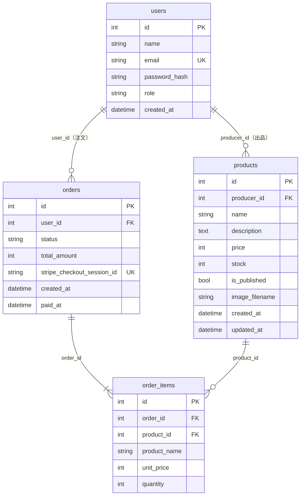

# データベース設計

前提: Flask-SQLAlchemy（SQLAlchemy 2 の `Mapped` / `mapped_column`）。開発とテストは SQLite、本番は MySQL 8.0 なので、どちらでも動く書き方にする（文字列のカラムには長さを付ける）。

## ER 図

カートはセッションに持つので、テーブルにしない。

## カラム定義

### users（ユーザー）

| カラム | 型 | 制約 | 説明 |
|-|-|-|-|
| id | Integer | PK | |
| name | String(50) | NOT NULL | 表示名 |
| email | String(255) | NOT NULL, UNIQUE | 小文字にそろえて保存 |
| password_hash | String(255) | NOT NULL | ハッシュ化したパスワード。平文は保存しない |
| role | String(20) | NOT NULL, 既定 `customer` | `customer` / `producer` / `admin` |
| created_at | DateTime | NOT NULL | 日本時間 |

### products（商品）

| カラム | 型 | 制約 | 説明 |
|-|-|-|-|
| id | Integer | PK | |
| producer_id | Integer | FK → users.id, NOT NULL, INDEX | 出品した生産者 |
| name | String(50) | NOT NULL | 商品名 |
| description | Text | NOT NULL, 既定 空文字 | 紹介文（アプリ側で 2,000 字まで） |
| price | Integer | NOT NULL, CHECK 50〜100000 | 円（税込み）の整数 |
| stock | Integer | NOT NULL, CHECK 0 以上 | 在庫数 |
| is_published | Boolean | NOT NULL, 既定 False | 公開中か。新規は非公開 |
| image_filename | String(100) | NULL 可 | 写真のファイル名（サーバーが付けた UUID。1枚、なくてもよい） |
| created_at | DateTime | NOT NULL | |
| updated_at | DateTime | NOT NULL | 更新時に書き換える |

### orders（注文）

| カラム | 型 | 制約 | 説明 |
|-|-|-|-|
| id | Integer | PK | |
| user_id | Integer | FK → users.id, NOT NULL, INDEX | 注文した人 |
| status | String(20) | NOT NULL, 既定 `pending`, INDEX | `pending`（支払い待ち）→ `paid`（支払い済み）または `cancelled`（キャンセル）。`OrderStatus` で持つ |
| total_amount | Integer | NOT NULL, CHECK 0 以上 | 合計金額。注文時にサーバーが明細から計算して保存 |
| stripe_checkout_session_id | String(255) | UNIQUE, NULL 可 | Checkout Session の ID。作成前は NULL |
| created_at | DateTime | NOT NULL | 注文日時 |
| paid_at | DateTime | NULL 可 | 支払い確定の日時 |

`stripe_checkout_session_id` は、注文を作った時点ではまだ ID がないので NULL を許す。UNIQUE は NULL を複数持てるので、SQLite でも MySQL でも問題ない。

### order_items（注文明細）

| カラム | 型 | 制約 | 説明 |
|-|-|-|-|
| id | Integer | PK | |
| order_id | Integer | FK → orders.id, NOT NULL, INDEX | |
| product_id | Integer | FK → products.id, NOT NULL, INDEX | 売上集計や在庫の戻しに使う |
| product_name | String(50) | NOT NULL | **注文時点**の商品名 |
| unit_price | Integer | NOT NULL, CHECK 0 以上 | **注文時点**の単価 |
| quantity | Integer | NOT NULL, CHECK 1〜10 | 数量 |

- `UNIQUE(order_id, product_id)`: 同じ商品が1つの注文に2行入らないようにする
- 小計は `unit_price * quantity` で求めるので、カラムにしない

## 外部キーの削除時の動き

| 外部キー | 動き | 理由 |
|-|-|-|
| products.producer_id → users.id | **RESTRICT** | 商品のあるユーザーは消せない。出品物が持ち主なしになるのを防ぐ |
| orders.user_id → users.id | **RESTRICT** | 注文履歴は売上の記録なので残す |
| order_items.order_id → orders.id | **CASCADE** | 明細は注文の一部。注文を消すなら一緒に消える（ORM 側も `cascade="all, delete-orphan"`） |
| order_items.product_id → products.id | **RESTRICT** | 注文のある商品は削除できない（非公開にする）。明細に商品名と単価を保存しているので表示は壊れないが、売上集計の元を残す |

## 注意点

- SQLite は、外部キーの制約を標準では守らない（MySQL は守る）。`PRAGMA` は SQLite 専用なので使わず、アプリ側でも削除前に「注文のある商品か」を確かめて弾く。RESTRICT はテストで確かめる
- 在庫は、支払い確定（Webhook）で `stock` を減らす。「いま買える数」は `marche/services/inventory.py` の `available_stock()` で、`stock` から「支払い待ちで、作成から `PENDING_MINUTES`（35 分）以内の注文」の数量の合計を引いて求める（0 未満にはしない）。35 分を過ぎた支払い待ちは、Checkout Session の期限（最短 30 分）が切れているので押さえない
- 注文のある商品は、注文の状態にかかわらず削除できない（`producer.delete` で確かめ、「非公開にしてください」と出す）
- CHECK 制約は MySQL 8.0.16 以上で効く。本番の 8.0 で問題ない
